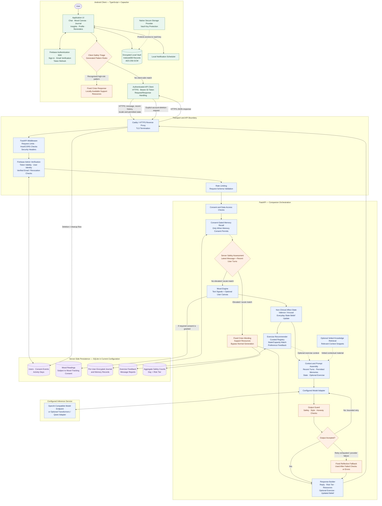
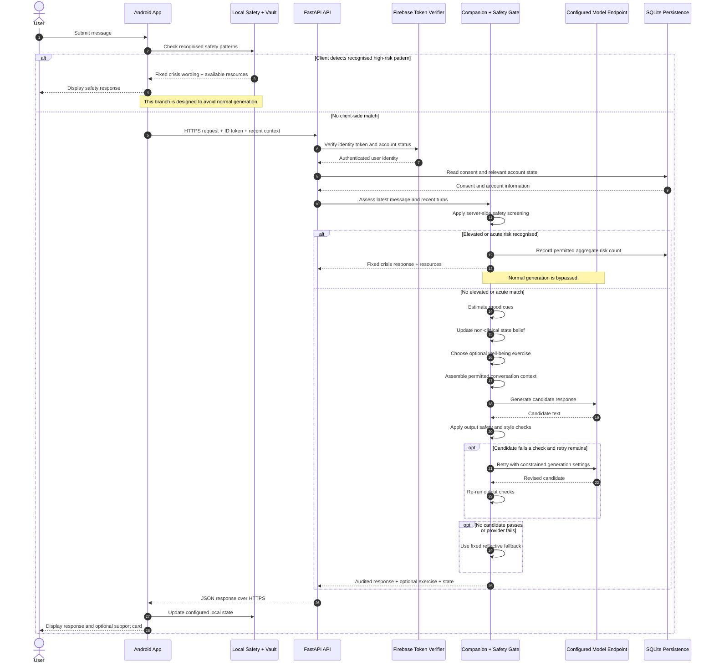

# MindSense AI

**A privacy-conscious AI companion for emotional reflection and everyday well-being.**

MindSense AI is an independent product and research project exploring how conversational AI can help people pause, put feelings into words, and reflect on their day—without presenting an AI system as a therapist or treating private thoughts as ordinary product analytics.

> **Project status:** Pre-release. The Android app and API source are present, but the release still requires a signed Android build, real-device testing, live-model evaluation, security checks, and independent review of safety language. Passing software tests is not evidence of clinical safety.

[Why MindSense?](#why-mindsense-ai) · [Features](#what-mindSense-does) · [Architecture](#architecture) · [Research direction](#research-and-evaluation) · [Run locally](#getting-started) · [Release readiness](#release-readiness)

---

## Why MindSense AI?

Life can move quickly. Stress, loneliness, and emotional overwhelm do not always arrive at a convenient time—or at a moment when someone knows how to explain what they are feeling. Sometimes the first step is simply having a little space to think, write something down, or make sense of a difficult day.

Mental health is a major public-health concern. The World Health Organization estimates that **5.2% of adults worldwide experienced depression in 2023**, and reports that **more than 720,000 people die by suicide each year**. These figures describe a challenge far larger than any single app can solve; they underline why accessible support, prevention, and qualified care matter.

Sources: [WHO: Depression](https://www.who.int/en/news-room/fact-sheets/detail/depression) · [WHO: Suicide](https://www.who.int/en/news-room/fact-sheets/detail/suicide)

My own experience with mental illness inspired me to explore how technology might make reflection and everyday emotional support easier to access. I started MindSense AI with a straightforward idea: **people should have room to reflect without feeling that every private thought must become permanent data.**

I think of MindSense as a private notebook with a thoughtful conversation partner beside it. The notebook helps someone record and revisit their own experience; the companion can listen, reflect, and offer a small optional next step. It should not claim to know a person better than they know themselves, and it should be clear about when human support is more appropriate.

## What is MindSense AI?

MindSense AI is a **non-clinical companion for emotional reflection**. It brings together mood check-ins, a private journal, reflective conversations with Mindy, weekly insights, reminders, and optional well-being exercises. Its goal is to make small acts of reflection easier to begin—not to diagnose a person, label their emotions as medical facts, or replace relationships and professional care.

MindSense is not a medical device or therapy service, does not diagnose or treat mental-health conditions, and is not designed for emergencies. It cannot replace qualified mental-health professionals or emergency services.

## What MindSense does

- **Mood check-ins:** Let people record how they feel using a valence-and-arousal canvas rather than relying only on text inference.
- **Private journaling:** Write and revisit personal reflections stored in the app's encrypted local vault.
- **Reflective conversations with Mindy:** Short, supportive exchanges designed to listen before jumping to advice.
- **Weekly insights:** Summarize patterns in opted-in mood data without presenting them as a diagnosis.
- **Optional well-being exercises:** Select from a curated registry of short activities; suggestions can be skipped and are not clinical prescriptions.
- **Reminders and profile controls:** Support user-directed routines and account management.
- **Safety screening:** Use deterministic patterns on the device and again on the backend to route certain recognised high-risk messages to fixed support wording rather than normal generation.
- **Message reporting and feedback:** Give users a way to report an AI response and optionally share the reported text for review.

---

## Research and evaluation

MindSense is also an evolving research and engineering project. I want to investigate what responsible emotional-support software looks like when privacy, uncertainty, and safety are treated as core design constraints rather than added at the end.

The project explores five questions:

1. **Safety before generation:** How can deterministic screening intercept clear, high-confidence warning signs before a language model responds, while limiting unnecessary false alarms?
2. **Language and context:** How do negation, indirect expressions, slang, transliteration, and code-switching affect distress detection across English, Hindi, Bengali, and Hinglish?
3. **Privacy-conscious personalization:** What useful reflection can be supported with local encrypted records and consent-gated memory, without keeping a server-side transcript archive?
4. **Bounded recommendations:** Can a curated set of well-being exercises make suggestions easier to inspect and evaluate than open-ended generated advice?
5. **Evaluation over claims:** How should the system be assessed for missed warning signs, false positives, response quality, fallback frequency, latency, and user understanding?

These are research questions, not results I claim to have proven. The current safety patterns are an engineering baseline, not a clinically validated crisis classifier. Mood estimates are exploratory signals, not calibrated measurements of a person's mental state. Meaningful next steps include held-out tests, native-speaker review, qualified mental-health review, and transparent reporting of failure cases.

---

# Architecture

MindSense uses a TypeScript/Capacitor Android client and a Python/FastAPI service. The client owns the primary local experience and can screen recognised safety phrases before sending a message. The API verifies the signed-in user, applies a second safety screen, assembles context, calls the configured model provider, audits the draft response, and returns either an audited answer or a fixed fallback.

The architecture is designed around three principles:

- **Safety before generation:** Recognised high-risk patterns should be handled by a dedicated safety path rather than ordinary response generation.
- **Privacy by design:** Sensitive data should be minimised, protected, and accessed only through explicit, documented data flows.
- **Inspectable behavior:** Mood signals, recommendations, safety routing, and model output checks should be testable independently rather than hidden inside one large prompt.

## 1. System architecture

The following diagram illustrates the main runtime components, request paths, trust boundaries, and persistence layers.



### How to read the architecture

**Client layer**

The Android application provides the user-facing experience. Mood entries and personal reflections can be encrypted locally. The client also performs an initial safety-pattern check before sending a chat request. The native secure-storage integration is intended to protect access to the encryption key.

**Transport and identity layer**

Requests travel over HTTPS through the configured reverse proxy. The API applies request validation and verifies Firebase identity tokens before accepting authenticated operations. Rate limits and middleware controls help reduce abuse, but they do not replace a full security review.

**Companion orchestration layer**

The FastAPI service coordinates safety screening, optional memory retrieval, mood-state estimation, exercise recommendations, context assembly, model inference, and output auditing.

**Safety layer**

The safety pipeline has two distinct checkpoints. The client can intercept recognised patterns before making an API request. The server reassesses the latest message and recent turns before normal generation. If the server recognises an elevated or acute risk pattern, it uses fixed support wording and resources rather than the standard LLM response path.

**Inference layer**

The configured model endpoint generates a candidate response only after the server-side safety gate permits normal generation. The output auditor evaluates the draft and can request a bounded retry or use a fixed fallback.

**Persistence layer**

SQLite currently holds the server's operational records. Depending on consent and enabled routes, these may include account and consent records, mood data, encrypted journal or memory records, reports, feedback, and aggregate safety counts. Local storage and backend storage are separate paths and should not be treated as interchangeable.

> **Important:** This is an engineering architecture, not proof that every depicted path has been validated in a production deployment. Review the implementation and runtime configuration before making privacy or security guarantees.

## 2. Chat request lifecycle

This sequence diagram shows how a message moves through the application, including the client safety check, authentication, the server safety gate, model generation, output auditing, and fallbacks.



## 3. Architecture layers and responsibilities

| Layer | Main components | Responsibility | Important limitation |
|---|---|---|---|
| **1. Client experience** | `app/src/main.ts`, `styles.css`, `notify.ts` | Chat, mood check-ins, journaling, insights, profile, reminders, and account actions | UI state is not a clinical record or diagnosis. |
| **2. Local data protection** | `app/src/vault.ts`, Capacitor secure storage | Encrypt local records using AES-GCM; bind ciphertext to a record key as additional authenticated data; remove the vault and key during a wipe | The browser fallback uses a non-extractable Web Crypto key in IndexedDB and is intended for development, not as a replacement for native Android key protection. |
| **3. Client safety triage** | `app/src/safety.ts`, `app/src/patterns.gen.ts` | Detect certain recognised patterns before sending a chat message | Pattern matching can miss indirect or contextual messages and can flag benign text. |
| **4. API boundary and identity** | `server.py`, Caddy deployment | Verify Firebase ID tokens, require verified email, apply rate limits and request validation, and enforce configured CORS/host controls and security headers | These controls reduce risk but do not constitute a completed security audit. |
| **5. Server safety gate** | `safety.py`, `Companion.reply()` | Reassess recent user turns and route recognised elevated/acute signals to fixed response wording and resources | The optional ML risk-model interface is not wired into the default companion construction in this project snapshot. |
| **6. Perception and state** | Mood engine, `affect.py` | Combine rough text-based mood cues with the user's optional valence/arousal canvas and update a belief over everyday felt states | Priors and cues are hand-set; the outputs are exploratory, not calibrated clinical estimates. |
| **7. Bounded support selection** | `exercises.json`, `Recommender` | Select optional activities from a fixed registry using state/capacity and helpful/not-helpful feedback | Exercise suggestions are well-being ideas, not treatment recommendations. |
| **8. Context and generation** | `KnowledgeBase`, `OpenAICompat`, optional `QwenTransformers` | Assemble recent conversation context, consent-permitted memories, optional vetted snippets, and an exercise offer; call the configured model endpoint | The inference host can see the prompt content required to generate a reply. Its retention and logging must be checked separately. |
| **9. Output audit** | `safety.check_output()`, `safety.audit_style()` | Reject selected unsafe, directive, misleading, or stylistically disallowed output; retry within a bound, then use a fallback | Rule-based auditing cannot guarantee that all unsafe or inaccurate output is caught. |
| **10. Persistence and governance** | `db.py`, `crypto.py`, consent/report/account routes | Store operational records, consent events, opted-in mood readings, aggregate safety events, feedback, reports, and encrypted per-user records | Local-vault storage and backend journal/memory endpoints are distinct data paths. Review which routes are enabled before describing the data as device-only. |

## 4. Data-flow and privacy boundaries

Privacy claims should match the shipped code and deployment, not just the design goal. MindSense has a local encrypted vault **and** backend endpoints for certain records, so the exact route matters.

| Data | Current design / code path | What users should understand |
|---|---|---|
| Local journal, check-ins, conversation history, state belief | Stored through the app's encrypted vault | On-device encryption depends on the native secure-storage key provider and device security. The web fallback is for development. |
| Message sent to Mindy | Sent to FastAPI with recent context and used by the configured inference endpoint | The API and model process the message to generate a response. “Not stored as chat history” does not mean “never processed” or “invisible to the model host.” |
| Mood readings | The backend persists readings only when the relevant `mood_tracking` consent is granted | Explain what is collected and retained in the privacy policy and Google Play Data safety form. |
| Journal and memories | The backend includes encrypted per-user journal and memory endpoints; memory access checks consent | The current mobile API module does not expose these endpoints as ordinary UI flows. Treat sync as a separate path and verify before enabling or advertising it. |
| Safety events | Day and risk-tier counts, without user ID or message text | Aggregate counts can help monitor trigger rates but cannot measure all missed crises by themselves. |
| Message reports | Text is stored only when the user chooses to include it; included text is encrypted | A reported message may be reviewed by an authorised administrator. The UI and privacy policy must explain this. |
| Shared feedback | Comments are sent to the team only when the user chooses to share them | Explain this opt-in clearly in the interface. |
| Account and consent | Firebase identity plus backend user and consent records | Account deletion must remove related records and the Firebase account. Test it end to end. |

The server currently uses SQLite, suitable for development or a carefully operated single-node deployment. Backups, master-key protection, access restrictions, monitoring, and restore procedures need to be configured and tested before real users rely on the service.

---

## Technology stack

| Area | Technology |
|---|---|
| Android client | TypeScript, Vite, Capacitor 8, Java Android shell |
| Authentication | Firebase Authentication in the client; Firebase Admin token verification in the API |
| API | Python, FastAPI, Pydantic |
| Inference integration | OpenAI-compatible endpoint by default; optional Transformers/Qwen adapter |
| Safety and output checks | Generated phrase patterns, deterministic screening, output guard, style/honesty auditor, fixed fallbacks |
| Mood and affect | Mood engine, valence/arousal circumplex, HMM-style belief update over non-clinical everyday states |
| Recommendations | Curated JSON exercise registry and feedback-based preference updates |
| Local encryption | Web Crypto AES-256-GCM, IndexedDB, Capacitor secure-storage plugin for native key material |
| Server persistence | SQLite with foreign keys, WAL, and per-user encrypted sensitive fields |
| Deployment/testing | Docker Compose, Caddy, encrypted backup script, pytest, Vitest, Locust, evaluation harness |

---

## Repository layout

```text
.
├── README.md                   # Product, research vision, detailed architecture
├── PRODUCTION_RUNBOOK.md       # Deployment, Android build, release gates
├── ARCHITECTURE_v2.md          # Design rationale and architectural history
├── MindSense_Blueprint.md      # Product and research blueprint
├── app/                        # Capacitor Android client
│   ├── src/
│   │   ├── main.ts             # UI and app flow
│   │   ├── api.ts              # Authenticated API client
│   │   ├── auth.ts             # Firebase auth flows
│   │   ├── vault.ts            # Encrypted local storage
│   │   ├── safety.ts           # Client safety triage
│   │   ├── patterns.gen.ts     # Generated safety patterns
│   │   ├── insights.ts         # Weekly insight helpers
│   │   └── notify.ts           # Local reminders
│   ├── tests/                  # Vitest client tests
│   └── android/                # Generated Android project
├── server.py                   # FastAPI routes, auth, consent and account flows
├── companion.py                # Safety-first companion, mood, retrieval, recommendations
├── safety.py                   # Server safety screening and output audits
├── affect.py                   # Valence/arousal and non-clinical state belief
├── crypto.py                   # Per-user encryption helpers for server records
├── db.py                       # SQLite schema and connection handling
├── exercises.json              # Curated well-being activity registry
├── gen_patterns.py             # Generates client patterns from server source
├── eval/                       # Evaluation cases, runner and report
├── loadtest/                   # Locust load-test scenario
├── deploy/                     # Docker, Caddy and backup configuration
└── site/                       # Draft privacy policy and deletion page
```

---

### Requirements

- Node.js 20 or later
- JDK 21
- Android Studio and Android SDK Platform 36 for the configured Android target
- Python version supported by the pinned/project dependencies
- Firebase project configured for email/password authentication and email verification
- A configured inference endpoint if you want live companion responses

### 1. Configure the app

```bash
cd app
cp .env.example .env
```

On Windows PowerShell:

```powershell
Copy-Item .env.example .env
```

Edit `.env` with the HTTPS API origin and Firebase web-app configuration values. Do not put Firebase service-account JSON, server master keys, model credentials, or production secrets in the client environment file or commit them to Git.

Then build and test the web client:

```bash
npm ci
npm test
npm run build
```

### 2. Generate/sync and open Android

From the `app/` directory:

```bash
npm run android:sync
npm run android:open
```

Connect a physical Android device, enable developer options and USB debugging, and run the app from Android Studio. Test authentication, local vault behavior, reminders, offline states, safety handling, and account deletion before preparing a release.

### 3. Run backend tests

From the repository root, create an appropriate virtual environment and install the API dependencies:

```bash
python -m venv .venv

# Activate the environment, then:
python -m pip install -r requirements-api.txt pytest
pytest -q
```

The API requires environment configuration described in `deploy/.env.example` and the runbook. Never expose a development server with development authentication enabled to the public internet.

### 4. Run the API locally

After configuring the required environment variables and Firebase credentials, start the API from the repository root:

```bash
uvicorn server:app --host 127.0.0.1 --port 8000
```

`GET /healthz` is the health endpoint. In development, API documentation is available at `/docs`; it is disabled when `MINDSENSE_ENV=prod`. Keep the model endpoint on a private network rather than exposing it directly to the public internet.


## Evaluation and responsible release

Passing unit tests verifies selected software behaviours; it does not establish clinical effectiveness or crisis-detection reliability.

Before public release, the project needs:

- A held-out safety evaluation set reviewed by qualified professionals and native speakers, covering English, Hindi, Bengali, Hinglish, negation, indirect expressions, quotation, sarcasm, and third-party concerns.
- A false-negative and false-positive review, with metrics reported per language and a clear discussion of dataset limits.
- Evaluation of the **actual configured model** for response quality, output-guard catches, fallback frequency, and p50/p95 latency.
- Load testing and a recovery drill for encrypted backups, plus dependency and secret scanning.
- Real-device testing for sign-in, email verification, data deletion, local key handling, reminders, accessibility, offline behaviour, and low-memory devices.
- Qualified mental-health review of crisis wording and the support flow; independent language review of localized phrases.
- Accurate privacy-policy, Data safety, health-app, content-rating, AI-generated-content reporting, and account-deletion declarations in Google Play Console.

The runbook records **79 mobile tests and 21 backend tests passing** in the snapshot it documents. Treat these as project-reported historical results and rerun the suites in your own checkout before using them as a current status claim.

## Known limitations

- Crisis detection is partly pattern-based. It can miss implicit, ambiguous, or unfamiliar phrasing and can trigger on benign text. It is not clinically validated.
- The optional ML risk-model hook is not enabled by the default `server.py` companion wiring.
- Mood and felt-state outputs are exploratory heuristics, not calibrated clinical probabilities or diagnoses.
- The real-model evaluation and live load test must be run against the exact inference service intended for release.
- The inference service receives the text/context needed to generate a response. Its retention and logging behaviour depend on the selected provider and deployment configuration.
- The backend exposes journal and memory endpoints even though the current mobile API module does not provide those flows as ordinary app actions. Audit these routes and privacy claims before enabling sync.
- An encrypted local vault does not provide recovery if the device and its key are lost. A passphrase-encrypted export/restore flow is a future improvement.
- Voice interaction, iOS support, and a complete in-app interface for inspecting and deleting remembered preferences are not verified parts of this release.
- The current SQLite configuration is single-node. A more scalable database and operational controls would be needed if usage grows.

---

## Roadmap

- [ ] Build and sign the Android App Bundle; test on physical Android devices.
- [ ] Audit current data flows and align the privacy policy with code and deployment configuration.
- [ ] Complete independent multilingual safety review and held-out evaluation.
- [ ] Evaluate the deployed model and load behaviour; publish reproducible metrics and failure cases.
- [ ] Complete security scans and a successful encrypted-backup restore drill.
- [ ] Finish Google Play declarations and closed/internal testing requirements for the account.
- [ ] Add transparent memory controls and encrypted export/restore.
- [ ] Consider voice and iOS only after the core product is validated.

## Contributing

Contributions that improve privacy, accessibility, language coverage, testing, safety evaluation, and deployment reproducibility are welcome. For safety-related changes, include the intended behaviour, reviewed examples, and regression tests.

Do not submit identifiable journal entries, private conversations, or datasets without appropriate permission and licensing.

## License

No `LICENSE` file is included yet, so the repository's reuse and redistribution terms have not been established. Add a license only after reviewing the dependencies, model weights, and datasets used by the project.

---

**Disclaimer:** MindSense AI is an independent, non-clinical software project. It is not a substitute for professional mental-health care and is not designed for emergencies. In India, call **112** for emergency assistance; Tele-MANAS can be reached at **14416**. Re-verify all support resources before release.
